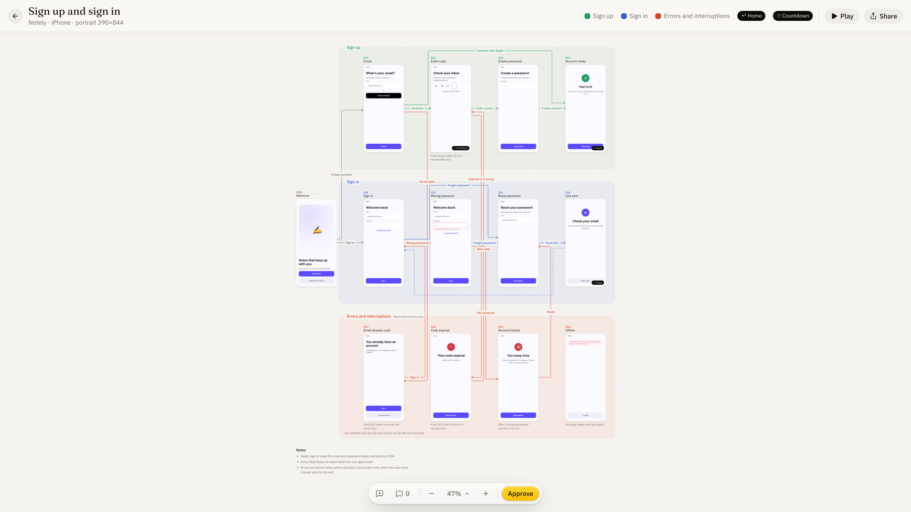
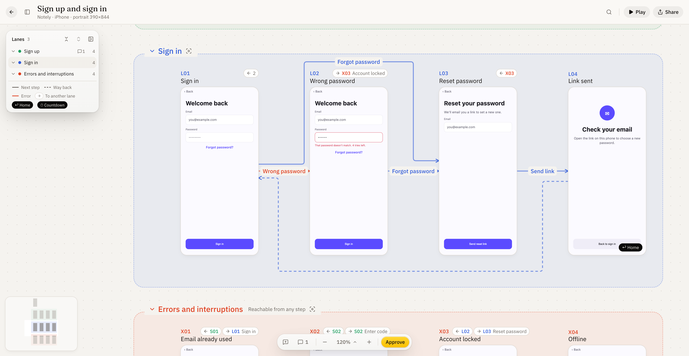
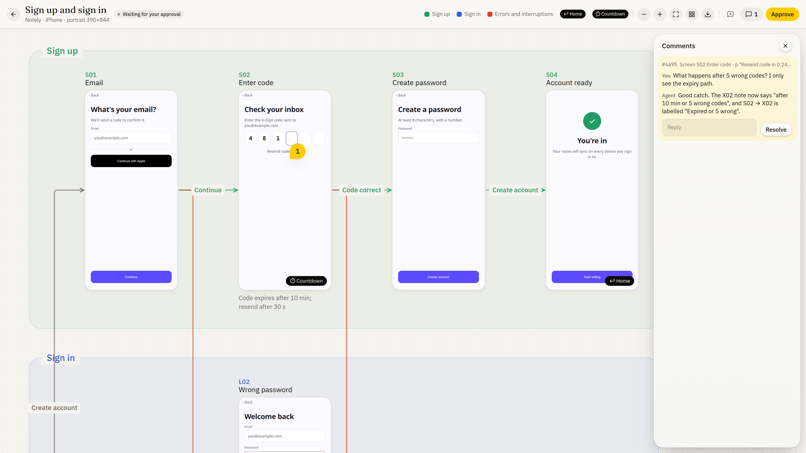
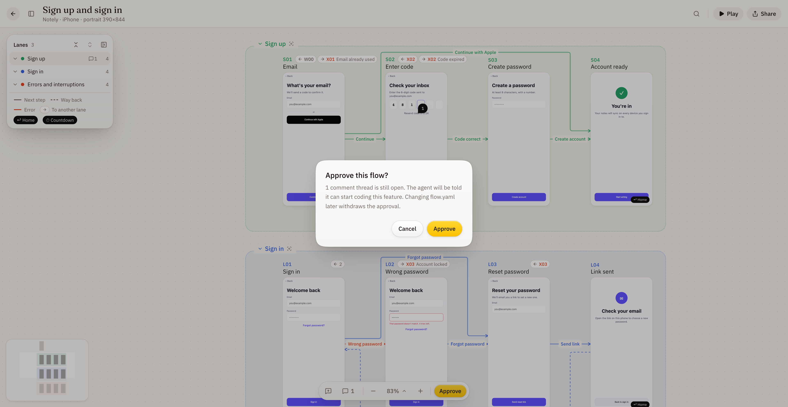
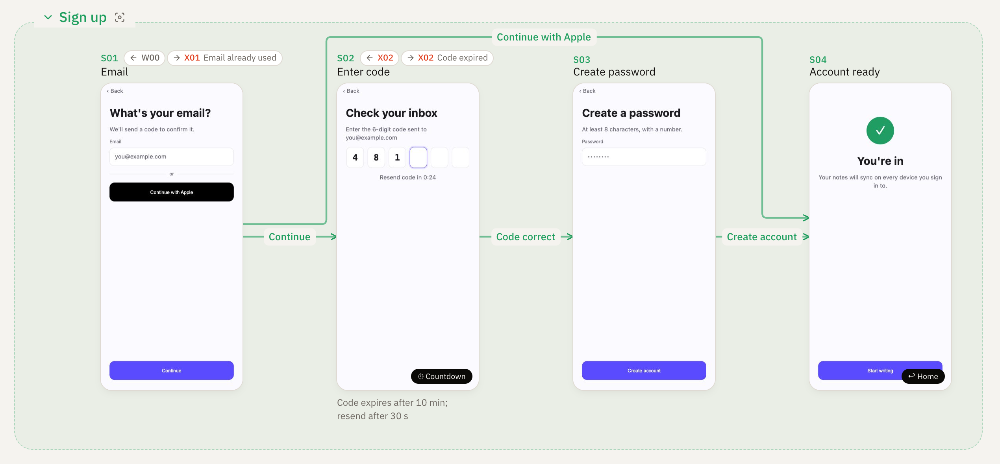
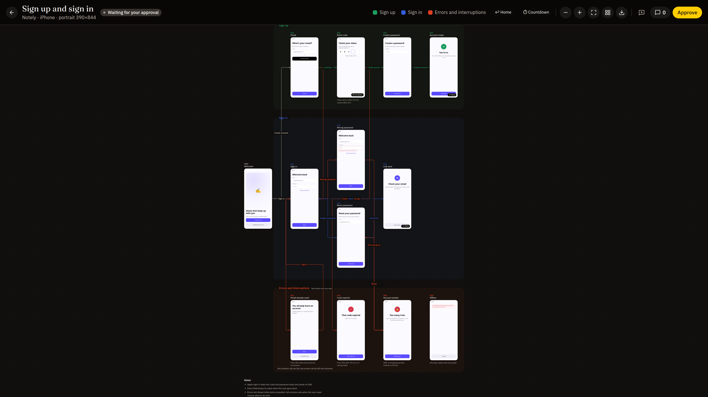

<h1 align="center">Design Flow</h1>

<p align="center">
  <b>A UX flow canvas your coding agent draws before it writes code.</b><br />
  Every screen, branch, error and way back, on one infinite canvas. You comment, the agent fixes it, you approve, then it codes.
</p>

<div align="center">
<b>Join our Discord group! ⬇️ 加入我们的 Discord 群组</b>

[](https://discord.gg/PwZDHH4mv3)
</div>

<p align="center">
  
</p>

Ask an agent to build a sign-up flow and it starts writing components. The branches it forgot (email already taken, code expired, five wrong passwords, offline) turn up in review, after the code exists.

With Design Flow, the agent first writes the flow as `.design-flow/<feature>/flow.yaml` (the lanes, the screens and the arrows between them) and `prototype.html` (every screen as one working page in your product's own style). A local server lays it out as a canvas and opens it in your browser. You click any button, field or arrow and leave a comment; the comment arrives in the agent's session; the agent changes the flow, replies, and the canvas updates while you watch. When it is right you press **Approve**, and only then does the agent start coding.

## Install

You need Node.js 20 or newer. The skill ships with everything it runs — the CLI, the server and the canvas — so there is nothing else to install.

Install it with the [skills CLI](https://github.com/vercel-labs/skills):

```bash
npx skills add stvlynn/design-flow
```

The CLI asks which agents to install it for (Claude Code, Codex, Cursor and others) and whether to install it for this project or for your user. To skip the questions:

```bash
npx skills add stvlynn/design-flow --skill design-flow --agent claude-code --yes
```

Add `-g` to install it for every project:

```bash
npx skills add stvlynn/design-flow --skill design-flow --agent claude-code -g --yes
```

The skill lands in `.claude/skills/design-flow/` (or `~/.claude/skills/design-flow/` with `-g`).

### Optional: the Claude Code plugin

The skill works on its own: it tells the agent to run `design-flow watch` in the background, so your comments reach it while you work. If you use Claude Code and want comments attached to your next message even when no watcher is running, install the repository as a plugin as well:

```bash
claude plugin marketplace add stvlynn/design-flow
```

```bash
claude plugin install design-flow@design-flow
```

The plugin adds a prompt hook (unread comments and approvals are attached to your next message), a stop hook (an agent about to stop while you have comments it has not read goes on to read them) and a monitor that streams them into the session. It loads in the next session, or after `/reload-plugins`. Plugin monitors need a recent Claude Code; on older versions the prompt hook still delivers comments. The hooks and the monitor look in the folder the session was opened in and in every folder the agent has run a `design-flow` command on in that session, so a canvas kept in another checkout (reached with `--project-dir`) still reaches the session working on it, and no other session.

## Use it

### 1. Ask for a feature with screens

The skill triggers on its own when you ask for something with screens or steps, or when you ask for a UX flow:

```text
Build sign-up and sign-in for the app. Draw the UX flow first.
```

In Claude Code you can also call it by name, at the start of your message:

```text
/design-flow sign-up and sign-in, including every error path
```

Installed as a plugin, the same skill is also available as `/design-flow:design-flow`.

The agent picks a feature name, runs `design-flow open sign-up`, and writes `.design-flow/sign-up/flow.yaml`. Your browser opens the canvas at `http://127.0.0.1:27420/…`.

### 2. Read the canvas

<p align="center">
  
</p>

- **Lanes** group the flow (sign up, sign in, errors). An error lane marked "reachable from any step" holds interruptions that can happen anywhere.
- **Frames** are the agent's HTML for each screen, rendered at the device's viewport in a sandbox with no network. Each has an id (`S02`) and a title.
- **Arrows** are labelled with the action or trigger. Red arrows are errors; dashed arrows go back. Arrows go around screens, never behind them: one that skips screens runs above them, and one that goes back runs below.
- **Badges** mark screens that return home, animate or count down; the **legend** and **notes** sit above and below.

Scroll to pan; ⌘-scroll, Ctrl-scroll or pinch to zoom, wherever the pointer is, from up to 800% out until the whole flow fits in the window, however big it is. ⌘+ and ⌘− zoom too (Ctrl on Windows and Linux), ⌘0 fits the whole flow in the window, and **Actual size** in the zoom menu shows screens at their real size. While you comment, scrolling over a screen that is longer than its frame scrolls that screen first, then the canvas. Screens stay where the layout puts them, so scrolling and dragging anywhere moves the canvas.

Far out, screens show as pictures, which the server draws in the background whenever a screen changes and keeps until it changes again. Close enough to read, at least about 160 × 100 px on screen, a screen becomes its live page, up to 16 at a time; while you comment, the screen under the pointer goes live too, so a click lands on an element in it. A flow with hundreds of screens opens in under a second and stays light however far you zoom.

Click a lane's title to collapse it to one row that says how many screens it holds and how many open comments; the lanes below move up, and arrows into and out of the lane end on that row, with ×3 on one that stands for three. Click the row to open the lane again. **Collapse all lanes** and **Expand all lanes** are in the zoom menu, and the button after a lane's title collapses every other lane and shows that one. Your browser remembers which lanes you collapsed on each canvas, and a lane opens by itself when search, a link or a comment takes you inside it.

Press ⌘K (Ctrl K) to find a screen by its id, name or lane and go straight to it. The minimap in the corner shows where you are in the flow; click or drag in it to move, or turn it off in the zoom menu. Zoomed out, screen ids and lane titles keep a readable size: lane titles until they would reach the next lane's, screen ids and titles until frames get too small to read, when they hide, as arrow labels do. The address bar follows you: it links the screen in the middle of the window (`#screen=S02`) or the comment you opened (`#thread=4a95ec3d`), so a copied link opens the canvas right there.

Screens play their animations only while they are on screen and at least about 160 × 100 px there; smaller or hidden ones pause until you zoom in, so a large flow sits idle instead of keeping the CPU busy.

### 3. Comment on anything

Press <kbd>C</kbd> and click: a button inside a screen, a screen's title, an arrow, a lane or empty canvas.

<p align="center">
  
</p>

The agent receives it where it is anchored:

```text
[design-flow] sign-up · new comment #4a95ec3d on Screen S02 Enter code · p "Resend code in 0:24" ([data-id="resend"]): What happens after 5 wrong codes? I only see the expiry path.
```

It changes `flow.yaml`, replies with `design-flow reply`, and resolves the thread when it is settled. Its reply appears under your comment; the canvas redraws as soon as the file changes. Until it answers, your last message says whether the agent has read it. A comment counts as read once a command the agent ran has shown it the text; a background watcher receiving it does not count, so a comment is never lost to a watcher nobody reads.

When the choice is yours to make, the agent replies with two to four options and marks the one it recommends; a click sends your pick back as your answer. When it can tell what you would likely want, it applies that and offers the other way as an option marked **Applied**, so changing course is one click too. After your pick the options fold into one line naming it, which opens them again if you change your mind.

The comment panel lists open threads with the numbers of their pins. Each names its screen and element in plain words (the ids are in its tooltip); click the name to go there, and the element flashes once. **Resolved** shows settled threads one line each, and **New** shows threads with agent replies you have not seen yet: a divider marks the first of them, and the comment button in the toolbar counts those threads. Pins stay on their element when the agent changes the screen, and a pin whose element is gone stays where you clicked.

The agent can start a thread as well. When a screen it draws depends on something only you know, such as a business rule or a priority, it asks on the canvas, pinned to that screen or element, with its options and the one it recommends.

### 4. Approve

<p align="center">
  
</p>

**Approve** records the exact version of `flow.yaml` you were looking at and tells the agent it may start coding. If the file changes afterwards, the approval is withdrawn and the canvas asks again. The agent does not code the feature until `design-flow status` says `approved`.

### Play

**Play** (top right) runs the screens as a working demo, fitted to your window at the device's size. Tap through it the way a user would: buttons go where the arrows say, **Back** returns, and anything the prototype keeps in its own state carries from screen to screen.

### Share

**Share** (top right) has three ways out:

- **Export HTML**: one file with the clickable demo and a list of screens. It opens in any browser, offline.
- **Export image**: the whole canvas as a PNG at 2×, with or without comment pins.
- **Create share link**: uploads that HTML as a secret GitHub gist with your own `gh` login and copies a link that opens the demo (served by [githack](https://raw.githack.com), which shows a one-click "Open the page" notice first). Anyone with the link can see it. Needs the [GitHub CLI](https://cli.github.com) and `gh auth login`.

<p align="center">
  
</p>

The canvas follows your system's light or dark mode; screens keep their own colors.

<p align="center">
  
</p>

## Commands

The agent runs these; you can too. `design-flow` is the skill's launcher:

```bash
node .claude/skills/design-flow/scripts/design-flow.mjs <command>
```

| Command | Does |
| --- | --- |
| `open <feature> [--no-open]` | Start the server, write a commented template if `flow.yaml` is missing, open the canvas |
| `check <feature> [--visual]` | Validate; prints `file:line:col`, the problem and a fix; exit 0 clean, 3 with issues. `--visual` also renders every screen and reports content wider than the screen, text cut off and text over text |
| `shot <feature> <screen>… [--lane <lane>]… [--sheet] [--element <selector>] [--scale 1\|2] [--out <file>] [--dir <dir>]` | PNGs of screens, or of one element, at 2× by default, in the temp directory unless `--out` or `--dir`; prints their paths. Several screens render in one browser; `--lane` adds a lane's screens; `--sheet` puts them on labelled overview images and prints those |
| `shot <feature> --all [--sheet] [--dir <dir>]` | A PNG of every screen, or sheets of them all |
| `outline <feature> [<screen>] [--json]` | The flow as text: screens, edges, open and unread threads. With a screen: its rendered elements, with boxes, selectors and `prototype.html` lines |
| `comments <feature> [--unread] [--json] [--shots]` | Threads, where each is anchored, and who said what; what it shows counts as read. `--shots` adds a shot of each commented screen with the element ringed, and a sheet of them all |
| `reply <feature> <thread> --text "…" [--option "…"]… [--recommend A] [--applied A]` | Reply as the agent, with two to four options you pick on the canvas if it gives them |
| `ask <feature> <screen> --text "…" [--element <selector>] [--option "…"]… [--recommend A] [--applied A]` | Start a thread as the agent, on a screen or one of its elements |
| `resolve <feature> <thread>` | Resolve a thread the agent has read to the end |
| `status <feature>` | `draft`, `approved` or `stale`, open and unread threads |
| `watch` | One line per new comment or approval; comments made close together print together |
| `list` / `stop` | Features in this project / stop the server |

Every command takes `--project-dir <path>`; the default is the current directory. Add `?lang=en` or `?lang=zh` to a canvas URL to pick the interface language.

### Letting the agent see the screens

An agent writes each screen's HTML without seeing it. `check --visual`, `shot` and `outline <feature> <screen>` render screens the way the canvas does, at their viewport, in headless Chrome, Chromium, Edge or Brave, whichever is installed; set `DESIGN_FLOW_CHROME` to a browser's executable to choose one. Each run starts a fresh browser with a throwaway profile and closes it when done; `shot` with several screens renders them all in that one browser, and `--sheet` lays them out on labelled overview images. `comments --shots` shows the agent each commented screen with your element ringed. Shots go to the system's temp directory, never into your project.

## flow.yaml

```yaml
version: 1
title: Sign up and sign in
viewport: { width: 390, height: 844 } # one screen in CSS px; a screen can override it
style: | # your styles, in every screen's <head>
  <style> .btn { padding: 14px; border-radius: 14px } .btn.main { background: #5b4bff; color: #fff } </style>
lanes:
  - { id: signup, title: Sign up, tone: success } # success | info | danger | neutral
  - { id: errors, title: Errors and interruptions, tone: danger, enter: any }
screens:
  - id: W00 # no lane: the entry column
    title: Welcome
    html: <h1>Notes that keep up with you</h1><button class="btn main" data-id="create">Create account</button>
  - id: S01
    lane: signup
    title: Email
    file: screens/s01.html # or keep the HTML in a file
  - id: X04
    lane: errors
    title: Offline
    badges: [home] # home | video | timer
    note: Any step; keeps what was typed
    html: <p>You're offline. We'll try again when you're back.</p>
edges:
  - { from: W00, to: S01, label: Create account }
  - { from: S01, to: X04, label: No network, kind: error } # normal | error | back
notes:
  - Every field keeps its value when the user goes back.
```

The full reference the agent follows is [`skills/design-flow/SKILL.md`](skills/design-flow/SKILL.md); the schema is [`skills/design-flow/schema/flow.v1.json`](skills/design-flow/schema/flow.v1.json). [`examples/notely`](examples/notely/.design-flow/sign-up/flow.yaml) is the flow in the screenshots.

## How it works

- One local server for the machine (port 27420, state in `~/.design-flow/`) serves every project; the CLI starts it on demand. It draws the pictures of screens with the same headless Chrome as `shot`, keeps them in `~/.design-flow/thumbs/` and deletes those not shown for a month. Without Chrome, the canvas shows every screen as a live page, as before.
- `flow.yaml` belongs to the agent. `comments.json`, `approval.json` and `.last-valid.yaml` belong to the tool, next to it. A `layout.json` from an older version, which kept dragged frames, is no longer read. While `flow.yaml` is broken the canvas keeps showing the last valid version and lists the problems.
- Screens run in sandboxed iframes with a content security policy that blocks network access; they can't reach your machine or the server.
- The server only answers requests from its own origin, so other websites cannot post comments into your agent's session or approve a flow.

## Develop

```bash
pnpm install
pnpm test        # vitest
pnpm typecheck
pnpm build       # tsc + vite, then bundles skills/design-flow/scripts/
```

`src/` is the CLI, server and core; `web/` is the canvas (React, React Flow, ELK); `scripts/bundle-skill.mjs` builds the self-contained skill.

## License

MIT
